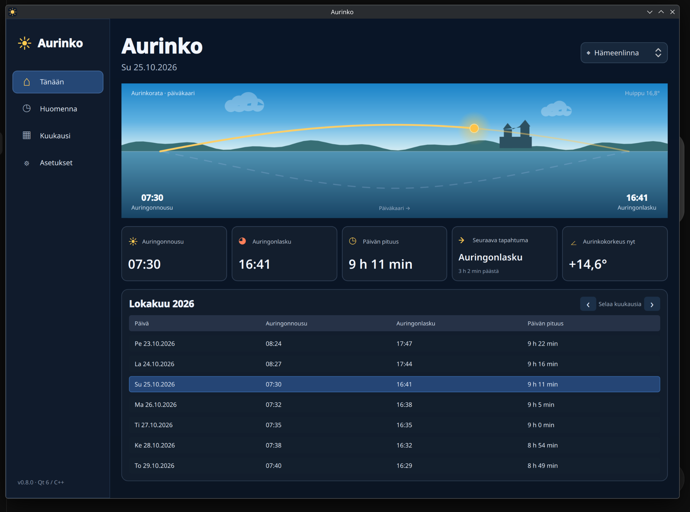

# Aurinko Desktop 0.8.2 ☀️

**Aurinko Desktop 0.8.2** on natiivi Linux-sovellus, joka näyttää auringonnousun, auringonlaskun, päivän pituuden ja auringon päivä- ja yökaaren. Sovellus on toteutettu **C++:lla ja Qt 6 / QML:llä**. Laskenta toimii täysin paikallisesti ilman verkkoyhteyttä.



*Kuvakaappaus 0.8-sarjan päivätilasta (kuvassa v0.8.0). Version 0.8.2 käyttöliittymä on vastaava.*

## Ominaisuudet

- Päivän ja yön aurinkokaari, aurinkokorkeus ja reaaliaikainen tapahtumalaskuri
- Auringonnousu, auringonlasku, päivän pituus ja kuukausitaulukko
- Tänään- ja Huomenna-näkymät sekä kalenterista valitut päivät
- Automaattinen paikallisen päivän ja kuukauden vaihto
- Kirkas päivätaivas, aamun ja illan hämärä sekä tumma yömaisema
- Valmiit kaupungit ja tallennettavat omat sijainnit (koordinaatit + IANA-aikavyöhyke)
- Offline-käyttö; Flatpak ei pyydä pääsyä verkkoon eikä kotihakemistoon

## Asennus: Flatpak (x86_64)

Lataa [v0.8.2-julkaisusta](https://github.com/janneok/aurinko-desktop/releases/tag/v0.8.2) tiedosto `Aurinko-0.8.2-x86_64.flatpak`. Tämä on *yksittäinen asennettava Flatpak-bundle*, ei Flathubissa julkaistu sovellus.

Asenna tarvittaessa Flatpak oman Linux-jakelusi ohjeen mukaan ja lisää Flathub tarvittavia Qt/KDE-ajoympäristöjä varten:

```bash
flatpak remote-add --user --if-not-exists flathub \
  https://dl.flathub.org/repo/flathub.flatpakrepo
flatpak install --user ./Aurinko-0.8.2-x86_64.flatpak
flatpak run fi.oksanen.Aurinko
```

Ensimmäinen asennus voi tarvita internetyhteyden KDE Platform 6.10 -kirjastojen lataamiseen. Sen jälkeen Aurinko itse toimii offline-tilassa. Omat sijainnit säilyvät Flatpakin asetuksissa.

Paketti on tarkoitettu **x86_64**-arkkitehtuurille. Lähdekoodi ja asennuspaketti ovat julkisesti saatavilla GitHubissa.

## Kehittäminen Fedorassa

```bash
sudo dnf install git gcc-c++ cmake ninja-build qt6-qtbase-devel qt6-qtdeclarative-devel qt-creator
cmake -S . -B build -G Ninja -DCMAKE_BUILD_TYPE=Debug
cmake --build build --parallel
ctest --test-dir build --output-on-failure
./build/aurinko-desktop
```

Flatpakin rakentaminen:

```bash
sudo dnf install flatpak flatpak-builder
./scripts/build-flatpak.sh
```

Skripti käyttää `stable`-haaraa ja tulostaa luodun Flatpak-tiedoston polun. Oletussijainti on `~/Projects/aurinko-flatpak-output/`.

## Projektin suhde verkkoversioon

Aurinko Desktop on erillinen projekti eikä muokkaa alkuperäistä [Aurinkosivua](https://aurinko.oksanen.cc) tai sen VPS-asennusta.

Lähdekoodi on julkaistu [MIT-lisenssillä](LICENSE).
